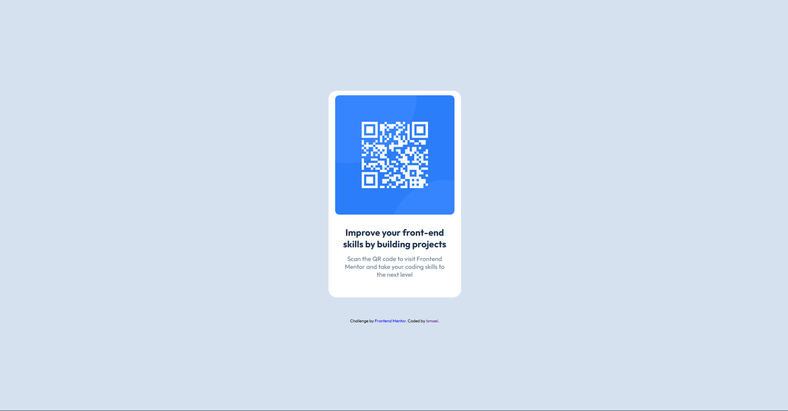

## Table of contents

- [Overview](#overview)
  - [Screenshot](#screenshot)
  - [Links](#links)
- [My process](#my-process)
  - [Built with](#built-with)
  - [What I learned](#what-i-learned)
  - [Continued development](#continued-development)
  - [AI Collaboration](#ai-collaboration)
- [Author](#author)

## Overview
This Project provides a single and centralized qr code card that once scanned take the visitor to the Frontend Mentor's website; a place where there are code challenges in order to help front-end developer improve their skills.

### Screenshot

### Links

- Solution URL: https://github.com/ismael-dev1/QR-code-component
- Live Site URL: https://ismael-dev1.github.io/QR-code-component/

## My process

### Built with

- Semantic HTML5 markup
- CSS custom properties
- Flexbox

### What I learned

I learned to use basic semantic HTML markup and CSS basic layout tools such as Flexbox, box model, font, colors and other essencial resources.

### Continued development

I intent to learn to build semantic, clean and resposive landing pages. 

### AI Collaboration

Describe how you used AI tools (if any) during this project. This helps demonstrate your ability to work effectively with AI assistants.

- What tools did you use?
  I used Deepseek.
- How did you use them?
  I tried to move down to the middle of the page (to the center), the div which is the background card that contains the intern elements that compose the qr code ("qr-code-card" in the code) but I couldn't because I hadn't given height to the parents tags body and html. I sent a screenshot to Deepseek asking what was the problem and he explained me about the ancestor's need to have a height too. 

- What worked well? What didn't?
  It was a good assistant and worked very well.

## Author

- Frontend Mentor - [@ismael-dev1](https://www.frontendmentor.io/profile/ismael-dev1)
